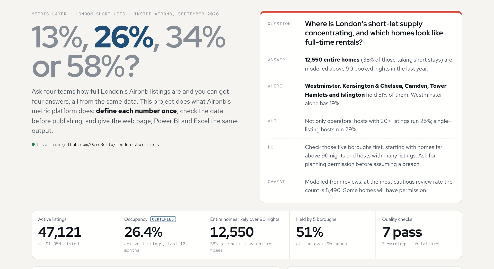
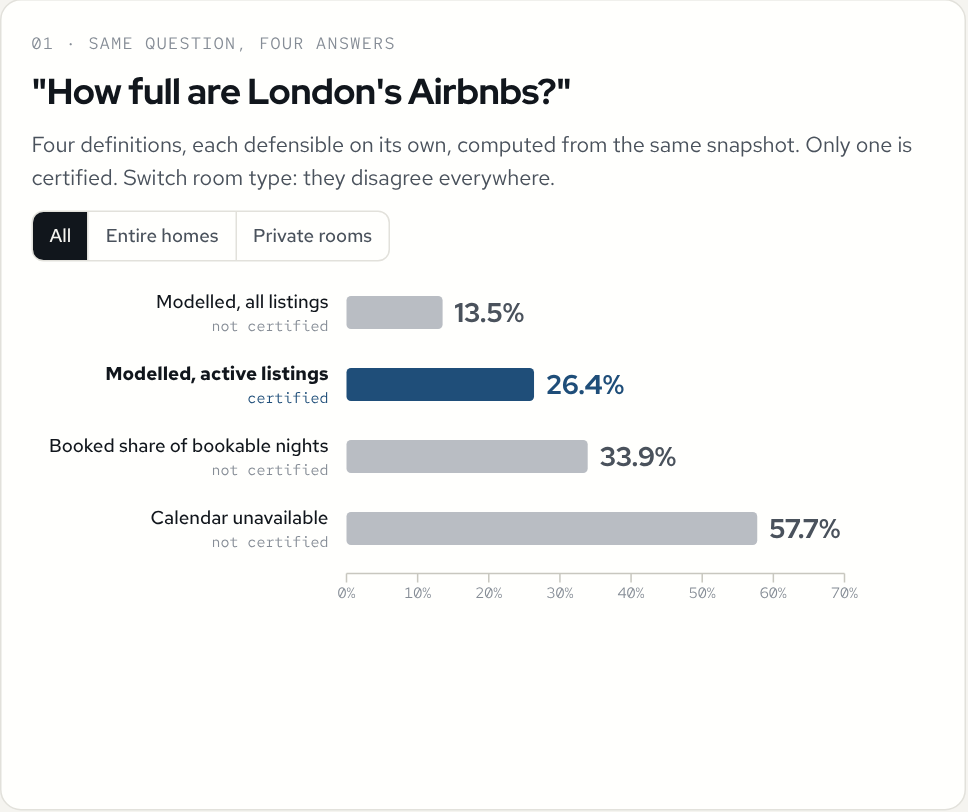
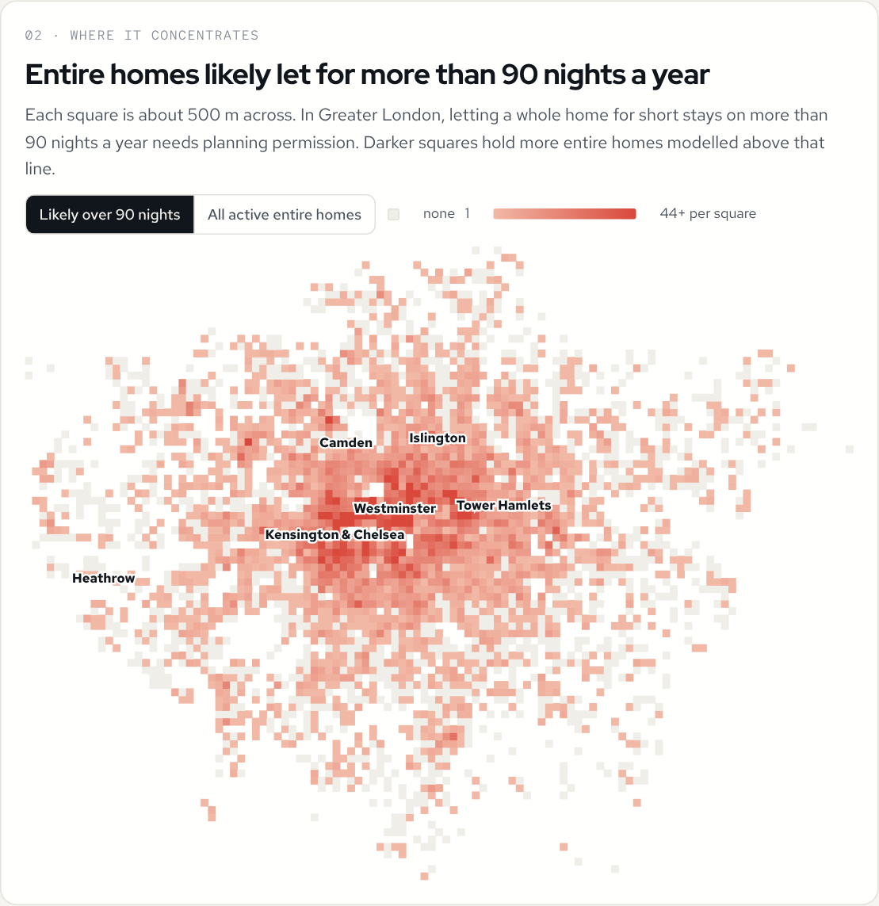
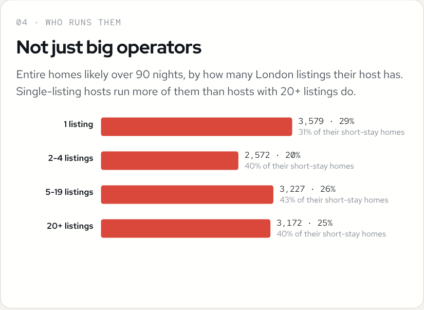
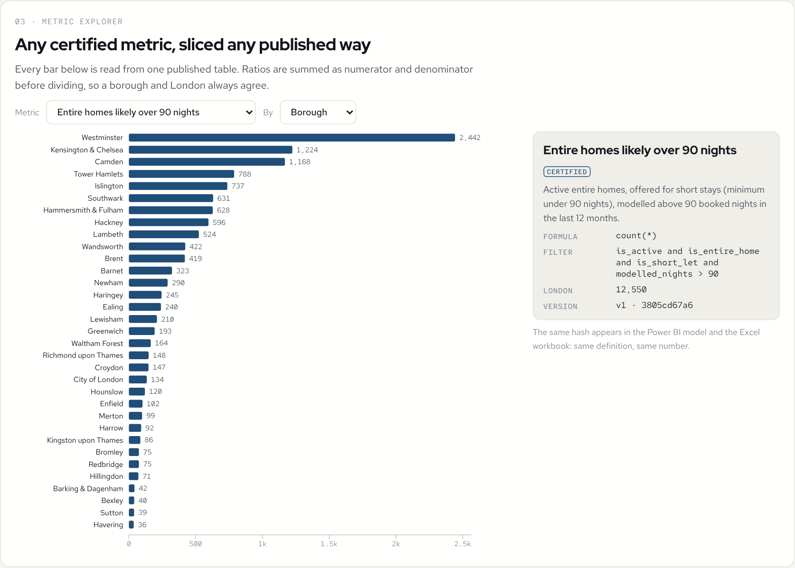
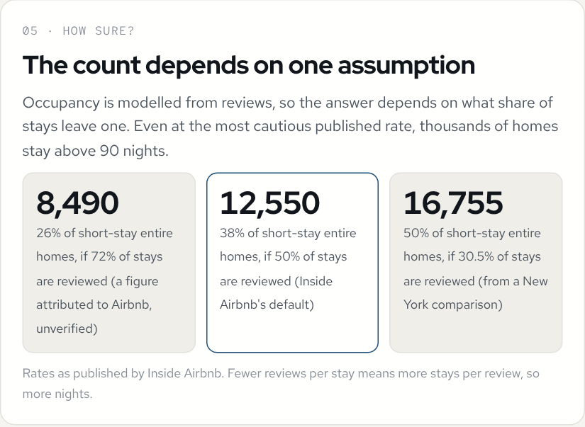

# 13%, 26%, 34% or 58%? One definition for London's short lets

**Ask how full London's Airbnb listings are and the same data gives four answers: 13.5%, 26.4%, 33.9% or 57.7%, depending on the definition.** This project rebuilds the idea behind Airbnb's own metric platform (define every metric once, check the data before publishing, give every tool the same output) on the Inside Airbnb London snapshot from September 2026, and ends with a decision memo.

**The finding:** 12,550 entire homes (38% of active short-stay entire homes) are modelled above the 90 nights a year that London allows without planning permission. Five boroughs hold half of them: Westminster, Kensington & Chelsea, Camden, Tower Hamlets and Islington. **[Read the memo](docs/decision-memo.md)**.

**[Open the live page →](https://qaisbello.github.io/data-engineering/london-short-lets/)** · reads `data/published/` from this repo on every load



## The idea

Airbnb's engineering blog describes how teams once reported different numbers for the same simple question, and how a central metric platform (Minerva) fixed it: metrics defined once in a shared repository, built-in data-quality checks, versioned definitions, and every dashboard, notebook and experiment reading the same output. This is that idea at portfolio scale.

| Piece | Here |
|---|---|
| **One definition per metric** | [`metrics.yml`](metrics.yml): 11 metrics, each with a type, filter, version and a definition hash. Uncertified alternatives are kept with a reason, so the conflict stays visible. |
| **Modelled in SQL** | [`models/`](models/): DuckDB SQL stages 91,954 listings, 33.6 million calendar nights and 2.3 million reviews into one fact table. |
| **Checked before publishing** | 10 checks in `metrics.yml`. An error-level failure stops the build, so nothing is published. Two checks prove the occupancy model is reproduced exactly from the raw reviews. |
| **Published once** | `data/published/metric_values.csv`: every metric for every published dimension (total, borough, room type, host size, borough × room type), with numerator and denominator. |
| **Read by every tool** | The web page, the [Power BI report](powerbi/) and the [Excel workbook](excel/) read that same table and agree to the last digit. |



## What the data says

| Question | Answer |
|---|---|
| How many listings are really trading? | 47,121 of 91,954 (51%) had a review in the last 12 months. |
| How full are they? | **26.4%** of the year (certified definition: modelled booked nights, active listings). |
| How many entire homes look like full-time short lets? | 12,550, modelled above 90 nights. Even at the most cautious review rate it is 8,490. |
| Where? | Westminster alone has 2,442 (19%); the top five boroughs hold 51%. The top five are the same under every review-rate assumption. |
| Who runs them? | Hosts with 20+ listings run 25%; single-listing hosts run 29%. |

| | |
|---|---|
|  |  |
|  |  |

## Ratios are published as parts

A metric layer must stop people averaging percentages. Every ratio is published as **numerator and denominator**, and every tool sums the parts before dividing. Counts and sums have no denominator and simply add up. The Power BI model has one generic measure built on this rule, and the Excel workbook uses SUMIFS on the parts. A test checks that the boroughs re-aggregate to London for every metric.

Building the Power BI checks caught a real bug: counts were first published with a denominator of 1, so adding 33 boroughs divided the total by 33. Counts now have an empty denominator.

## Repo layout

```
metrics.yml                    the metric registry: parameters, dimensions, metrics, checks
models/*.sql                   DuckDB staging and the fact table every metric reads
src/pipeline.py                stage -> check -> compute -> publish (run this)
src/build_dashboard.py         web page (dashboard/index.html) from src/dashboard_template.html
src/build_excel.py             Excel consumer (excel/London_Short_Lets_Metrics.xlsx)
data/raw/                      the Inside Airbnb files (not committed: see data/raw/README.md)
data/staged/                   staged tables, committed so the build runs without the raw files
data/published/                metric_values.csv, definitions, quality report, map grid, sensitivity, summary
powerbi/                       Power BI project (.pbip) reading data/published/
tests/test_metrics.py          9 checks on the published metrics
docs/decision-memo.md          the one-page memo
docs/occupancy-model.md        how occupancy is modelled, and the 90-night rule
```

## Run it

```bash
pip install -r requirements.txt
python src/pipeline.py          # stops if an error-level check fails
pytest -q
python src/build_dashboard.py
python src/build_excel.py
```

A GitHub Action reruns everything when a definition, model or staged file changes, and republishes.

## Limits

- Occupancy is modelled from reviews, not bookings. The assumptions are in [`docs/occupancy-model.md`](docs/occupancy-model.md) and the sensitivity table.
- Above 90 nights is a flag to check, not a breach: a host may have planning permission, and the model covers the last 12 months while the rule counts calendar years.
- Airbnb moves listing locations by up to 150 m, so the map squares are approximate.
- One snapshot. Inside Airbnb publishes a new one about every quarter; the pipeline reruns on it unchanged.

Data: [Inside Airbnb](https://insideairbnb.com/), London, scraped 18-22 September 2026. Not affiliated with Airbnb.

---
Analysis and metric layer by **Qais Adeniji-Bello** · [qaisbello.github.io](https://qaisbello.github.io) · [LinkedIn](https://www.linkedin.com/in/qais-adeniji-bello/)
